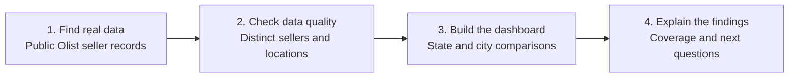
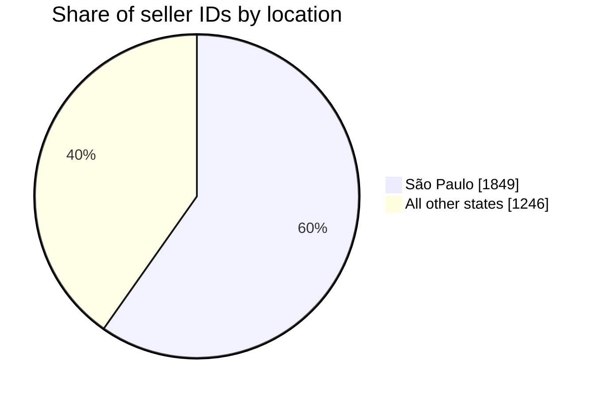

# Order Fulfilment & Delivery Performance Intelligence

**A supply chain business analysis project using real public Olist marketplace data from Brazil (2016-2018).**

**The goal:** Turn disconnected operational data into a clear view of seller coverage, customer delivery and potential service issues, so an operations manager can decide where to investigate.

> **Current project status:** The seller-location analysis is complete and supported by real records. Customer delivery analysis is the next stage because the full order transaction files have not yet been loaded. The published dashboard does **not** claim an on-time delivery rate.

**[Explore the Excel dashboard](workbook/Olist_Order_Fulfilment_Intelligence.xlsx)** | **[Read the business findings](docs/05_findings.md)** | **[View the data source](https://www.kaggle.com/datasets/olistbr/brazilian-ecommerce)**

## The business problem

An online marketplace serves customers through many independent sellers. Operations teams need to understand where sellers are based and, ultimately, whether orders are reaching customers when expected.

Before comparing service performance, the business needs reliable data. A dashboard can be misleading if it counts a seller twice, mixes different kinds of transactions or reports a delivery percentage when delivery records are missing.

This project starts with the evidence available, checks it, presents a clear picture of the seller network and sets out how the analysis can grow into a complete customer-delivery review.

## What I did

| Stage | My work | Why it matters |
|---|---|---|
| **Understand the problem** | Defined what an operations manager needs to know about seller coverage and delivery performance. | Keeps the analysis focused on business decisions. |
| **Prepare the information** | Reviewed real seller records, checked seller IDs and grouped locations by state and city. | Prevents misleading counts and inconsistent comparisons. |
| **Visualise the findings** | Created an Excel dashboard with geographic summaries, a chart and supporting definitions. | Makes the information understandable without reading raw data. |
| **Identify next steps** | Documented what can be concluded now and which additional order records are needed for delivery analysis. | Separates verified results from assumptions. |

## Results from the data analysed so far

<strong>What does the seller network look like?</strong>

The verified source contains **3,095 distinct seller IDs** across **23 Brazilian states**. São Paulo accounts for **1,849 sellers (59.7%)**, with Paraná and Minas Gerais next.

| Key result | Verified observation |
|---|---:|
| Sellers in the public source | **3,095** |
| Brazilian states represented | **23** |
| Sellers located in São Paulo (SP) | **1,849** |
| São Paulo share | **59.7%** |
| Sellers located in Paraná (PR) | **349** |
| Sellers located in Minas Gerais (MG) | **244** |

### Where the sellers are concentrated

**Main finding:** Nearly six in ten recorded sellers are based in São Paulo. This highlights a geographic concentration worth investigating when reviewing marketplace coverage or logistics planning.

**Important distinction:** Seller location tells us where sellers are registered in this dataset. It does **not** tell us which sellers ship the most orders, deliver late, have warehouse capacity or provide better service.

The dashboard also compares the largest seller states and shows the data still needed for customer-delivery reporting.

## What business decisions could this support?

| Business question | What this project provides |
|---|---|
| Where is our seller network concentrated? | A verified state-level and city-level view of the seller population. |
| Which locations deserve further review? | A starting point for questions about regional coverage and logistics dependency. |
| Can we compare delivery performance yet? | Not yet. The published workbook identifies the missing transaction data rather than inventing results. |
| What should an operations manager investigate next? | Order delivery dates, delays by month, freight costs, seller-level order activity and customer reviews once the original records are available. |

These are **investigation priorities**, not claims of proven delivery problems or achieved business savings.

## The next stage: from seller coverage to customer delivery

The original Olist dataset also contains customer orders, order items, estimated delivery dates, actual delivery dates, payments, products and customer reviews. With those original files available, the project is designed to answer:

- **Delivery reliability:** What percentage of delivered orders reached customers by their estimated date?
- **Delivery delays:** In which periods are late deliveries most common?
- **Freight and product mix:** Which categories account for larger item and freight values?
- **Customer experience:** Are late deliveries associated with different review scores?

These are **planned analyses, not completed results**. The Excel dashboard currently labels order-level figures as **Not loaded**. It would be inaccurate to report a delivery rate before running and checking the underlying order records.

## View the project

| Start here | What you will see |
|---|---|
| [Excel dashboard](workbook/Olist_Order_Fulfilment_Intelligence.xlsx) | Seller coverage, charts, definitions and clear indications of unavailable delivery figures. |
| [Business case](docs/01_business_case.md) | The problem, stakeholders and decisions this project is designed to support. |
| [Key findings](docs/05_findings.md) | Verified observations, their meaning and practical follow-up questions. |
| [Data quality](docs/04_data_quality.md) | How the analysis checks counts, sources and reliability. |
| [Project roadmap](docs/06_roadmap.md) | What is needed to extend the work to actual delivery performance. |

For reviewers who want the code or reproduction steps

See the [technical setup guide](docs/08_technical_setup.md), [data model](docs/02_data_model.md), [KPI definitions](docs/03_kpi_dictionary.md) and [requirements traceability](docs/07_requirements_traceability.md). The Python scripts and tests are included for independent review.

## Source and project boundaries

**Source:** [Brazilian E-Commerce Public Dataset by Olist](https://www.kaggle.com/datasets/olistbr/brazilian-ecommerce), historical Brazil data covering 2016-2018. The seller-location summaries were calculated from the [public Olist sellers CSV](https://raw.githubusercontent.com/spdrio/Brazilian-E-Commerce-Public-Dataset-by-Olist/master/files/olist_sellers_dataset.csv) and can be checked in the [source summary](data/reference/olist_seller_state_profile.csv) and [provenance notes](data/reference/PROVENANCE.md).

The original Olist source is made available under the publisher's stated **CC BY-NC-SA 4.0** licence. This is an independent portfolio case study, not a live system for Olist or a New Zealand business. Values in the original order data are **BRL**, not NZD.

The source does **not** establish incoming supplier OTIF, purchase-order overdue balances, inventory stockouts or supplier purchasing spend. Those would require different operational records.

*Portfolio focus: understanding the business problem, checking source information, presenting evidence and recommending the next decision.*
