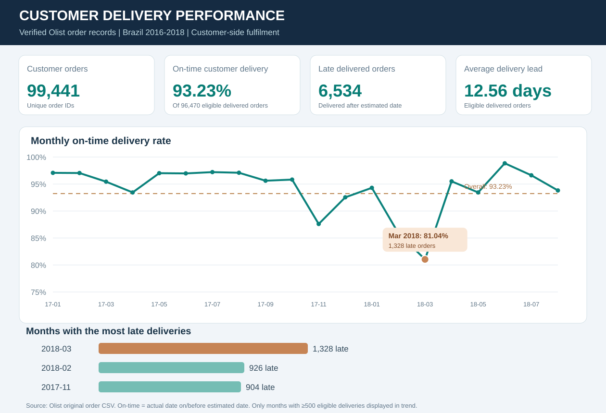
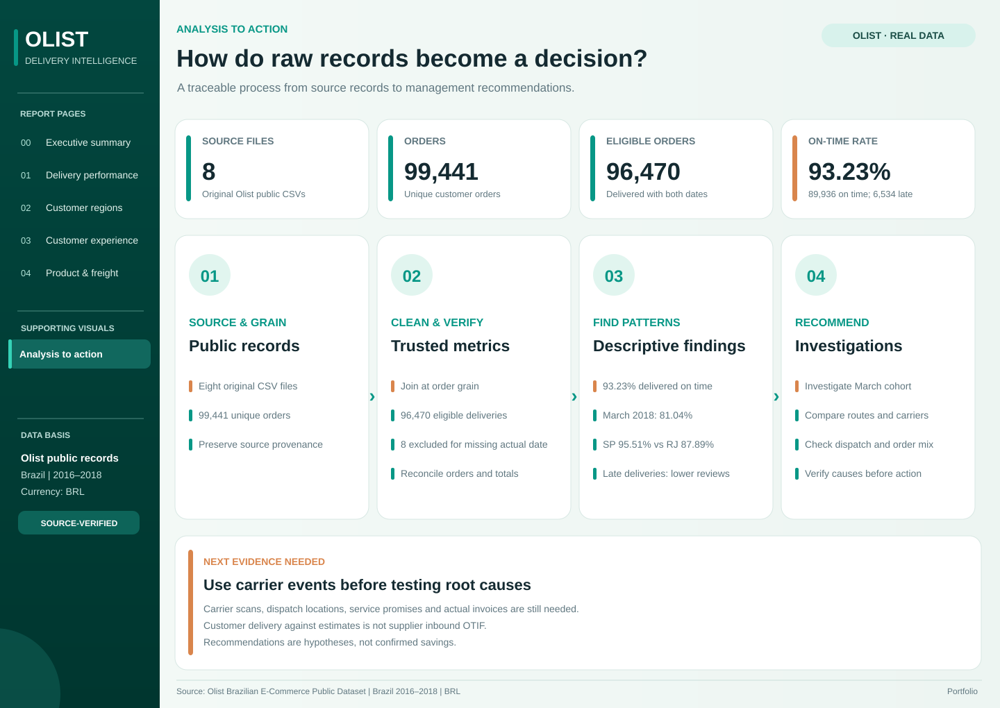
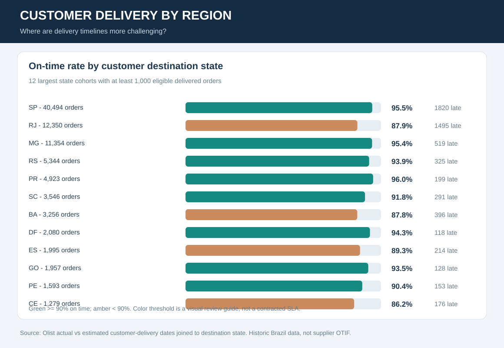
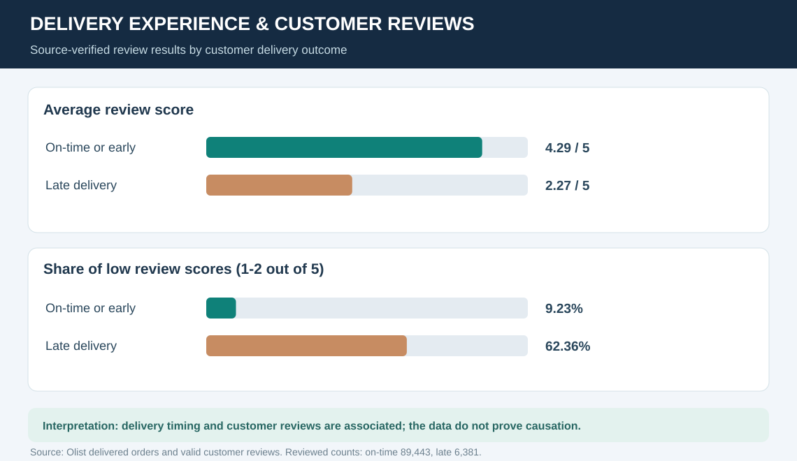
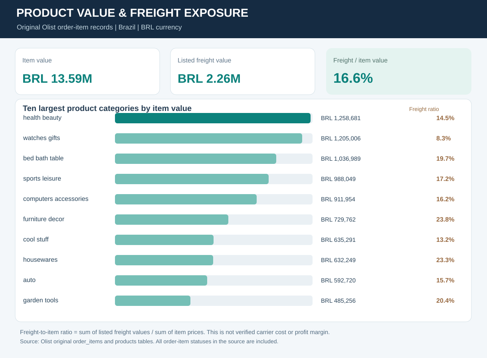
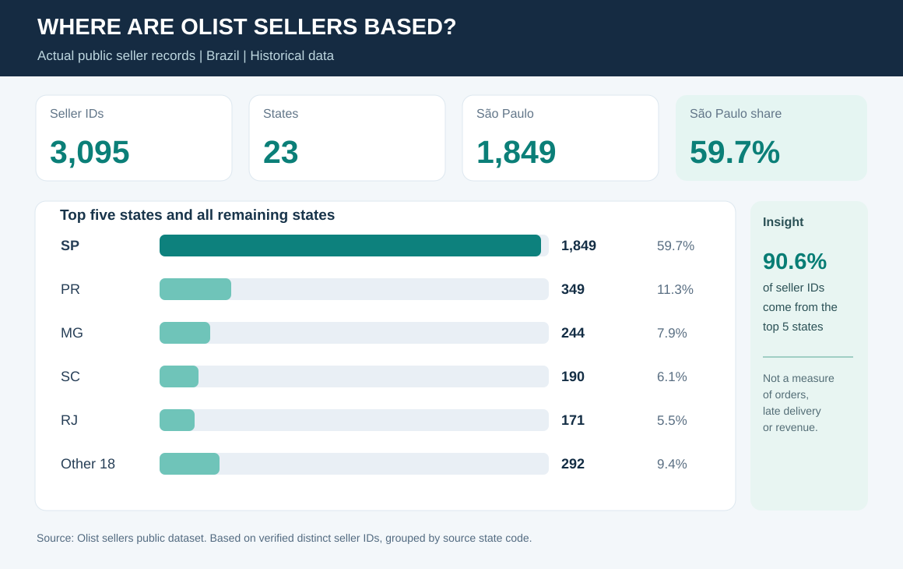

# Olist Order Fulfilment & Delivery Intelligence

**Business Analysis portfolio | Real order and delivery data | Brazil, 2016-2018**

**The business question:** Are customers receiving orders on time, which periods and regions need attention, and how does delivery experience relate to customer feedback?

## The results in one minute

| Measure | Result |
|---|---:|
| Real customer orders analysed | **99,441** |
| On-time customer delivery | **93.23%** |
| Delivered orders arriving late | **6,534** |
| Average order-to-delivery time | **12.56 days** |
| Canceled orders | **625 (0.63%)** |

**Measurement basis:** 96,470 delivered orders have both estimated and actual customer-delivery dates. 89,936 of them arrived on or before the estimated calendar date. Eight orders marked delivered lacked the actual date and were excluded.

**[Read the management findings](docs/10_delivery_performance_findings.md) | [See the original Olist source](https://github.com/olist/work-at-olist-data) | [Check source calculations](data/processed/kpi_summary.json)**

## What I investigated

The analysis connects orders, order items, customer locations and customer reviews. I checked the original records, defined who qualifies for each KPI, reconciled totals and translated the findings into management questions.

## Finding 1. Delivery performance changes by month

**March 2018 stands out:** 1,328 late orders and an on-time rate of **81.04%** among 7,003 eligible deliveries. February 2018 and November 2017 also deserve review. The dataset does not by itself establish why these orders were late.

## Finding 2. Delivery performance differs by destination

On-time delivery was **95.51% for São Paulo (40,494 eligible orders)** and **87.89% for Rio de Janeiro (12,350 eligible orders)**. This supports a closer review of routes, carrier coverage or order mix, but those potential explanations need additional evidence.

## Finding 3. Late orders have lower review scores

Reviewed on-time orders average **4.29/5**, compared with **2.27/5** for reviewed late orders. The difference is substantial but observational: it does **not** prove delivery delays are the only cause of dissatisfaction.

## Finding 4. Freight deserves category-level attention

The dataset shows **BRL 13.59 million** in listed item value and **BRL 2.26 million** in listed freight, a ratio of **16.60%**. This can guide investigation of categories with relatively high freight exposure, but listed freight is not verified carrier cost.

## Business decisions supported

| For an Operations Manager | Evidence to review |
|---|---|
| Which periods should receive a closer delivery-service investigation? | Monthly on-time rate and late-order counts |
| Which customer destinations differ most? | State-level delivery performance with sample sizes |
| Where should customer-service follow-up be considered? | Delivery timing alongside customer review outcomes |
| Which product groups merit more freight analysis? | Category item value and listed freight ratio |

**These are investigation recommendations, not claims that operational changes were implemented or produced savings.**

## Seller network - supporting context

The same public data contain **3,095 distinct marketplace seller IDs** across 23 Brazilian state codes; **59.7%** are in São Paulo state. Seller location is not a measure of on-time performance, revenue or warehouse capacity.

## Explore the project

- **[Management Findings](docs/10_delivery_performance_findings.md)** - visual evidence, interpretation and suggested actions.
- **[Verified KPI summary](data/processed/kpi_summary.json)** and **[monthly results](data/processed/monthly_metrics.csv)** - reproducible evidence.
- **[Region results](data/processed/customer_region_summary.csv)** and **[review results](data/processed/review_by_delivery.csv)** - aggregated data without order identifiers.
- **[Excel workbook](workbook/Olist_Order_Fulfilment_Intelligence.xlsx)** - the published seller-geography workbook; see status note below.
- **[Business case](docs/01_business_case.md)** and **[data-quality controls](docs/04_data_quality.md)** - requirements and validation approach.
- **[Technical reproduction](docs/08_technical_setup.md)** - for reviewers who want the code or original data.
- **[Source provenance](data/processed/PROVENANCE.json)** - original Olist repository commit and scope.

**Excel status:** Full transaction analysis and these visual findings are now published. The GitHub Excel workbook is still the earlier seller-coverage edition, and its delivery cells have not yet been refreshed. The charts above and the linked output files contain the verified delivery results.

## Source and boundaries

Data: [Olist's own public GitHub datasets](https://github.com/olist/work-at-olist-data) and [Brazilian E-Commerce Public Dataset by Olist](https://www.kaggle.com/datasets/olistbr/brazilian-ecommerce), historical Brazil, 2016-2018. Transaction amounts are **BRL**, not NZD. Original transaction files are not redistributed in this portfolio repository. Check Olist's dataset licence before reuse.

This project measures **customer delivery relative to the estimated customer date**, not upstream supplier OTIF. The source does not contain actual supplier purchase orders, goods receipts, warehouse inventory or invoice-verified purchasing costs. It is an independent portfolio study, not a live business system.
