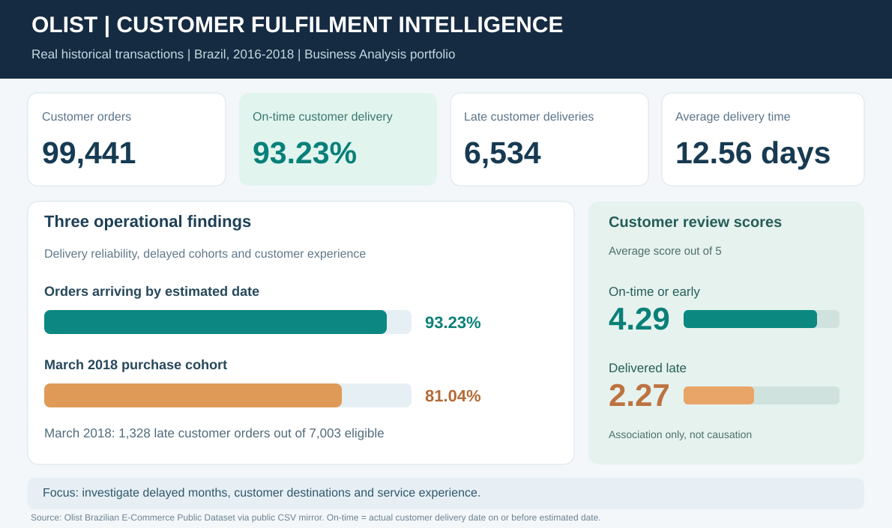
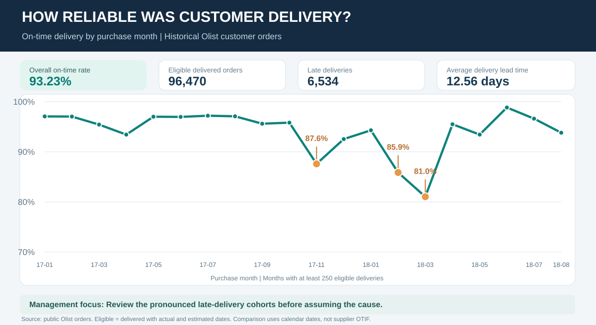
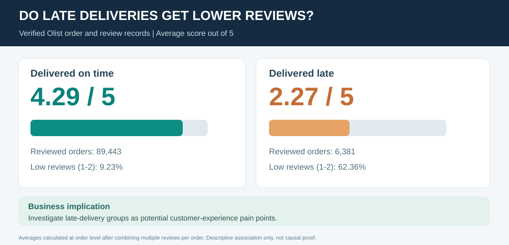
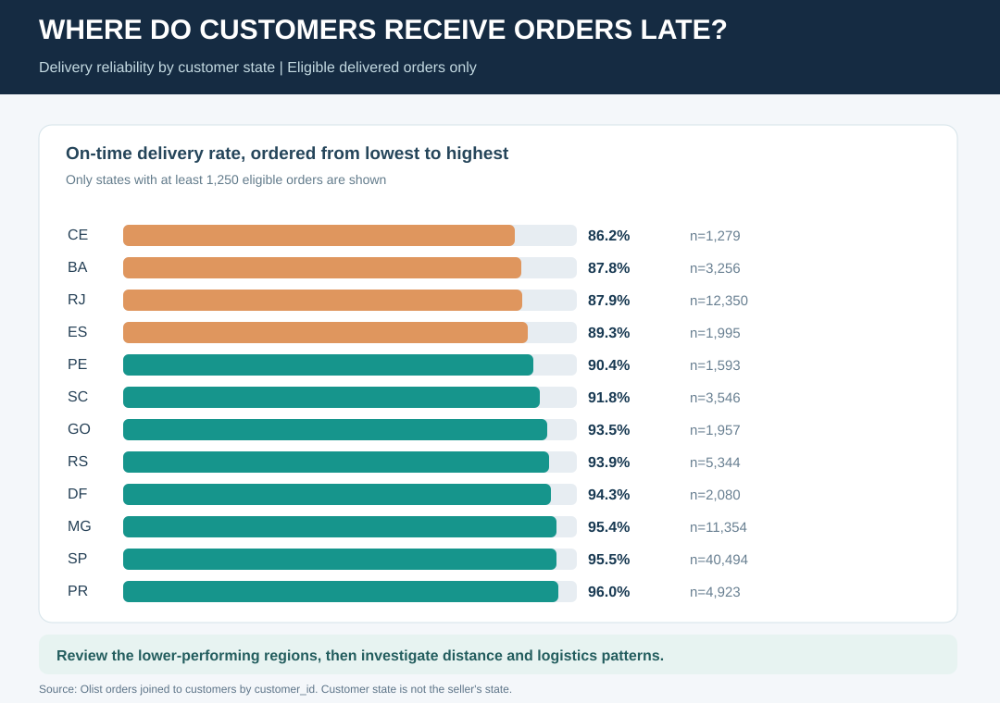
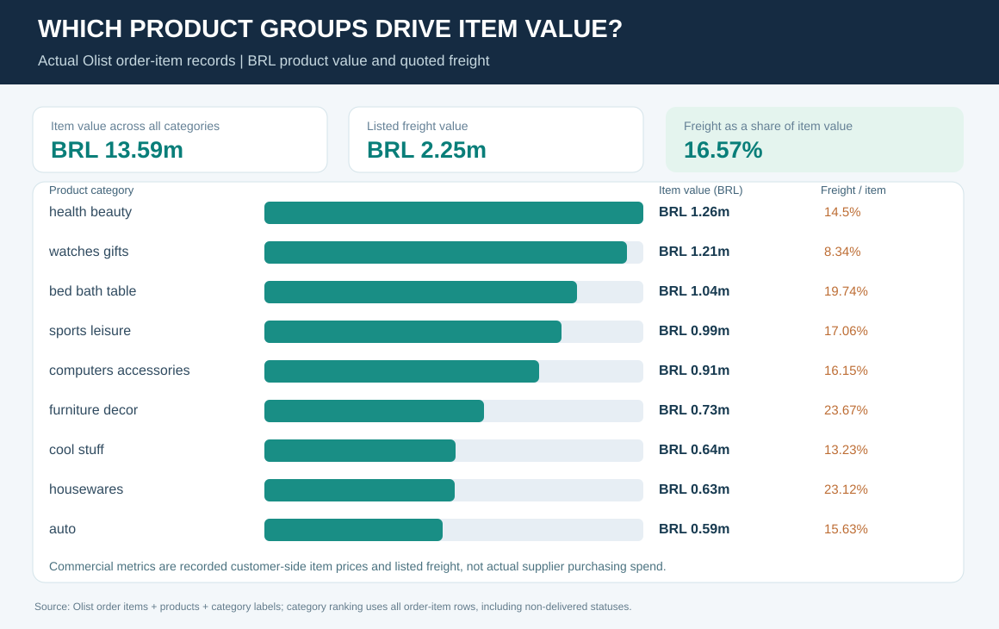

# Olist Order Fulfilment & Delivery Intelligence

**Supply Chain / Business Analysis Portfolio | Real Olist transactions | Brazil, 2016-2018**

**Business question:** How reliably were customer orders delivered, where did delays occur, and how were delivery outcomes associated with customer experience?

**[Management Brief](docs/09_management_brief.md) | [Key Findings](docs/05_findings.md) | [Excel (seller-preview version)](workbook/Olist_Order_Fulfilment_Intelligence.xlsx)**

## The results in four numbers

| Actual Olist observation | Verified result |
|---|---:|
| Customer orders analysed | **99,441** |
| Orders delivered with both dates available | **96,470** |
| Delivered on or before estimated date | **93.23%** |
| Orders delivered later than estimated | **6,534** |

Delivery lead time averaged **12.56 days** from purchase to customer receipt for delivered orders with usable timestamps. The average lateness among late deliveries was **10.62 calendar days**.

**Definition:** On-time compares the recorded **actual customer delivery date** to the **estimated delivery date**, using calendar days. This is not supplier inbound OTIF, and it is not a carrier contract SLA.

## What the analysis revealed

### 1. Delivery performance varied sharply by purchase month

Only **81.04%** of eligible orders placed in **March 2018** arrived by the estimated date (1,328 late out of 7,003 eligible). February 2018 was **85.87%** and November 2017 **87.60%**.

These three purchase-month groups account for **3,158 of 6,534 late orders (48.3%)**, despite making up only **21.6%** of eligible deliveries. This is a useful starting point for investigating seasonal pressure, geography and logistics, not proof of the cause.

### 2. Customer experience differed substantially

| Delivery result | Average review score | Reviewed eligible orders |
|---|---:|---:|
| On-time or early | **4.29 / 5** | **89,443** |
| Late | **2.27 / 5** | **6,381** |

Orders were grouped by on-time status, with multiple reviews averaged **within each order** before comparing groups. This is an **association**, not evidence that lateness caused low ratings.

### 3. Some customer regions showed lower delivery reliability

For states with at least 1,250 eligible orders, Ceará (**86.24%**), Bahia (**87.84%**) and Rio de Janeiro (**87.89%**) were among the lowest on-time groups in the displayed comparison.

**Next question:** Do travel distance, product mix or logistics processes help explain the differences? The source does not establish the cause.

### 4. Freight matters alongside product value

Across **112,650 order-item rows**, the source lists **BRL 13.59 million** of item prices and **BRL 2.25 million** of freight values. Freight equals **16.57% of item value** as a descriptive ratio. These are customer-side listed amounts, **not** supplier purchasing expenditure or verified carrier invoices.

## From data to an operational decision

| Management question | Practical decision support |
|---|---|
| **When were delays most prominent?** | Prioritise the March 2018, February 2018 and November 2017 purchase cohorts for deeper review. |
| **Where should regional delivery be investigated?** | Compare customer-state results while considering eligible-order counts and product mix. |
| **How are delays related to customer experience?** | Review late-delivery cases and satisfaction patterns without assuming causality. |
| **Which categories have significant freight exposure?** | Examine item-value and freight-to-item-value comparisons before making cost decisions. |

## Earlier analysis: marketplace seller coverage

The real Olist seller table contains **3,095 distinct seller IDs** in **23 Brazilian states**; **59.7%** are registered in São Paulo state. Seller geographic concentration is useful context, but it is not a measure of late shipments.

[View the seller geography chart](evidence/seller_state_concentration.svg) and [top cities](evidence/top_seller_cities.svg).

## Explore the project

- **[Management Brief](docs/09_management_brief.md)** - visual summary with findings and business recommendations.
- **[Excel (seller-preview version)](workbook/Olist_Order_Fulfilment_Intelligence.xlsx)** - the existing GitHub workbook has not yet been replaced with the newly prepared 16-sheet full-analysis workbook; the published visual findings above use verified transaction aggregates.
- **[Data & QA Evidence](evidence/)** - source-derived, aggregated calculations and charts.
- **[Business Case](docs/01_business_case.md)** and **[KPI Dictionary](docs/03_kpi_dictionary.md)** - requirements and metric boundaries.
- **[Technical Setup](docs/08_technical_setup.md)** - reproducibility steps for technical reviewers.

## Source and limitations

The results use the **[Brazilian E-Commerce Public Dataset by Olist](https://www.kaggle.com/datasets/olistbr/brazilian-ecommerce)**, accessed through a [public GitHub mirror of the original CSVs](https://github.com/anggid/Brazilian-E-Commerce-Public-Dataset-by-Olist). All published metrics are aggregate calculations from actual historical, anonymised transactions. Original raw transactions are **not redistributed** in this repository. The original dataset is published with a **CC BY-NC-SA 4.0** licence; follow publisher conditions before downstream reuse.

This is an independent historic Brazil case study, **not** a real-time Olist service, Würth operation or NZ purchasing system. Commercial values are in **BRL**. The dataset cannot establish supplier purchase orders, inbound OTIF, inventory stockouts, actual upstream procurement spend or operational improvements already achieved.

**Accuracy note:** Business recommendations are investigation priorities based on observed associations. They are not claims of proven root causes, commercial savings or stakeholder sign-off.
