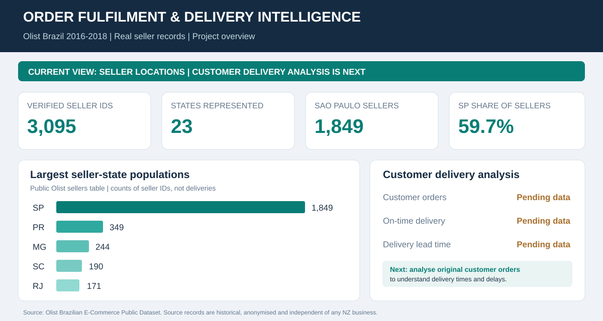

# Order Fulfilment & Delivery Performance Intelligence

**Real-data supply chain operations portfolio | Excel + Python | Brazilian E-Commerce Public Dataset by Olist (2016-2018)**

A reproducible business analysis project that follows the customer order lifecycle from purchase to delivery and reviews. It adapts the **functional structure**, not the synthetic transactions, of an earlier 22-sheet SCM dashboard to a single coherent public dataset.



**[Open the Excel dashboard](workbook/Olist_Order_Fulfilment_Intelligence.xlsx)** · **[View dashboard overview](evidence/dashboard_overview.svg)** · **[Business requirements](docs/01_business_case.md)** · **[Source and QA evidence](docs/04_data_quality.md)**

## Release status

**Stage 1 published in this package: verified seller footprint.** The [published Excel workbook](workbook/Olist_Order_Fulfilment_Intelligence.xlsx) contains a real Olist marketplace seller-state profile from **3,095 distinct seller IDs**, with summary by 23 Brazilian states and top 20 cities. The full transactional order/item/payment CSVs are **not bundled** and were not available to the builder's environment. Therefore this packaged workbook correctly displays **Not loaded** for order counts, delivery timeliness and other order-level metrics. No delivery percentages were fabricated.

**Stage 2 implemented and ready to run:** A complete standard-library Python ETL and Excel builder. Download the **original Olist CSVs** from the publisher and run the provided commands to calculate real delivery, commercial and QA results. Do not present the Stage 2 KPIs as observed results until the source files are supplied and the pipeline is run.

## Observed seller footprint

| Actual source observation | Verified result |
|---|---:|
| Seller records / distinct seller IDs | 3,095 |
| Brazilian states represented | 23 |
| Seller IDs in São Paulo (SP) | 1,849 |
| Share of seller IDs in SP | 59.7% |
| Seller IDs in Paraná (PR) | 349 |
| Seller IDs in Minas Gerais (MG) | 244 |

**Interpretation:** The recorded marketplace seller presence is concentrated in São Paulo. Seller counts do not measure order volume, customer service quality or delivery lateness. Reference data: [Seller State Profile](data/reference/olist_seller_state_profile.csv), [Seller City Top 20](data/reference/olist_seller_city_top20.csv), [provenance](data/reference/PROVENANCE.md).

## Business problem

Marketplace operations teams need to know whether customers receive orders by their estimated date, whether delays differ across purchase months, and whether freight, product mix and marketplace seller participation create service-risk questions. Order items, payments and reviews occupy different grains, so careless joins can multiply amounts and create misleading KPI results.

The project defines a testable analysis with the correct denominators and the correct evidence boundaries. The workbook starts from the seller footprint available now and refreshes into a delivery analytics report after the full dataset is loaded.

## Data source and licence

- **Publisher:** Olist. [Brazilian E-Commerce Public Dataset by Olist - Kaggle](https://www.kaggle.com/datasets/olistbr/brazilian-ecommerce).
- **Region / historical period:** Brazil, 2016-2018. **Currency:** BRL, not NZD.
- **Licence stated by publisher:** [CC BY-NC-SA 4.0](https://creativecommons.org/licenses/by-nc-sa/4.0/). Attribution, noncommercial and share-alike conditions apply to the source dataset. The original Olist dataset is **not included in this repository**; check the publisher's terms before redistributing any derivations.
- **Verified initial reference:** [Public mirror of Olist sellers CSV](https://raw.githubusercontent.com/spdrio/Brazilian-E-Commerce-Public-Dataset-by-Olist/master/files/olist_sellers_dataset.csv), used only to compute the state/city aggregates.

## How to complete the real-data analysis

Python 3.10+ and `artifact_tool` are used for the workbook builder; the ETL itself uses only the Python standard library.

1. Download the original Olist dataset from the Kaggle link, or optionally run `python scripts/download_olist.py` (public automatic download is network-dependent).
2. Place these **eight CSV files** in `data/raw/`: `olist_orders_dataset.csv`, `olist_order_items_dataset.csv`, `olist_order_payments_dataset.csv`, `olist_order_reviews_dataset.csv`, `olist_products_dataset.csv`, `olist_sellers_dataset.csv`, `olist_customers_dataset.csv`, `product_category_name_translation.csv`. Geolocation is optional and not required.
3. Run:

```bash
python scripts/process_olist.py --raw data/raw --output data/processed
python scripts/build_workbook.py --processed data/processed --output workbook/Olist_Order_Fulfilment_Intelligence.xlsx
python -m unittest discover -s tests -v
```

On Mac/Linux, `sh scripts/run_pipeline.sh` executes these commands in sequence. For the workbook builder, install `artifact_tool` if not already available in your environment.

After processing, the script creates `data/processed/kpi_summary.json`, `orders_enriched.csv`, `monthly_metrics.csv`, `seller_summary.csv`, `category_summary.csv` and `seller_state_counts.csv`. **The workbook is generated from those computed files; it is not a static mock dashboard.**

## Workbook sections

| Worksheet | What is delivered |
|---|---|
| `DASHBOARD` | Verified seller geography now; customer delivery KPIs once original source CSVs are processed |
| `MONTHLY_DELIVERY` | Purchase-month delivery timeliness, with eligible denominator |
| `SELLER_SALES` | Seller-attributed item price and freight values, not upstream supplier performance |
| `CATEGORY_ANALYSIS` | Product-category item values, using published category translation |
| `ORDER_SAMPLE` | Up to 300 real processed orders for formula/source spot checking (not a statistical sample) |
| `SELLER_STATES` and `SELLER_CITIES` | Real 3,095-seller footprint aggregates |
| `DATA_QA` | Data availability, source linkage, monthly reconciliation and value consistency flags |
| `KPI_DICTIONARY`, `BA_REQUIREMENTS`, `SOURCE_LOG`, `HOW_TO_USE` | KPI governance, traceability, provenance and user guidance |

## Scope and caveats

- **On-time customer delivery** can be measured: delivered orders with both actual and estimated delivery dates, compared at calendar-date precision.
- **Supplier OTIF is not measured**: the original data do not provide warehouse accepted quantity versus the original ordered quantity for upstream purchase orders.
- **PO overdue, inventory and supplier purchasing spend are not measured**: the dataset contains no upstream purchase orders, inventory ledger or supplier AP invoices.
- `order_items.price` and `freight_value` are customer-side transaction fields. `order_payments.payment_value` is payment information from customers, not purchasing cost.
- A single order can have many items, several payment records and several review records. The script aggregates item and payment data separately to `order_id` first, to prevent many-to-many duplication.
- Seller category/revenue splits are item-grain attributed measures. An order can contribute to several sellers/categories, so attributed order counts must never be summed across groups as if mutually exclusive.
- `order_estimated_delivery_date` is a promised/estimated customer date in the public dataset, not a carrier SLA or verified contract commitment.
- Dataset is a historical, anonymised marketplace case study, not real-time operations for Würth or any New Zealand company. No measured company savings are claimed.

## Review evidence and BA material

- [Business case and stakeholders](docs/01_business_case.md)
- [Data model / grain / transformations](docs/02_data_model.md)
- [KPI dictionary and boundaries](docs/03_kpi_dictionary.md)
- [Data quality and acceptance testing](docs/04_data_quality.md)
- [Evidence-based findings](docs/05_findings.md)
- [Deployment and further roadmap](docs/06_roadmap.md)
- [Requirements traceability](docs/07_requirements_traceability.md)

The project is an **independent portfolio demonstration**, not a production implementation or a representation of working for Olist. The business scenarios and suggested actions are analytical proposals, not evidence of operational impact.