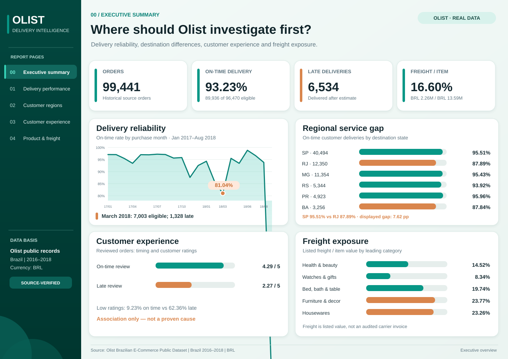

# Olist Order Fulfilment & Delivery Intelligence

**Real-data Business Analysis portfolio | Brazil, 2016-2018**

**Business question:** Are customer orders arriving when expected, and where should an operations team investigate service and freight exposure?

**Executive summary:** Across 96,470 delivery-eligible orders, 93.23% arrived by the estimated date. The March 2018 purchase cohort and some destination states show weaker performance, while late deliveries are associated with lower customer reviews. **Next business action:** investigate these exceptions with carrier and fulfilment records before attributing causes or claiming cost savings.

**[Open the Excel dashboard](workbook/Olist_Order_Fulfilment_Intelligence_Real_Data.xlsx)** | **[Management brief](docs/09_management_brief.md)**

## What the analysis found

1. **Delivery reliability:** 89,936 of 96,470 eligible delivered orders arrived on or before the estimated date, an **on-time rate of 93.23%**. Across the full historical dataset there were **99,441 orders** and **6,534 late deliveries**.
2. **When to investigate:** Orders purchased in March 2018 had **1,328 late deliveries** and an **81.04% on-time rate**, compared with 93.23% across the eligible source population.
3. **Where to investigate:** São Paulo (SP) had **95.51%** on-time delivery across 40,494 eligible orders, while Rio de Janeiro (RJ) had **87.89%** across 12,350.
4. **Customer experience:** Orders with valid reviews averaged **4.29 / 5** when delivered on time or early, versus **2.27 / 5** when late. This is an association, not proof of cause.
5. **Freight exposure:** Listed item value totalled **BRL 13.59M** and listed freight **BRL 2.26M**, equivalent to **16.60%** of item value. This is not independently verified carrier cost.

## What should a manager do next?

| Decision area | Suggested investigation |
|---|---|
| Delivery exceptions | Examine the March 2018 order cohort and compare fulfilment events, service promises and seasonal demand. |
| Regional reliability | Compare customer destinations with dispatch origin, carrier coverage and order mix before attributing a root cause. |
| Customer experience | Review delayed orders with negative feedback and evaluate possible service-recovery measures. |
| Freight | Examine categories with higher freight-to-item ratios using actual carrier invoices and profitability data before recommending savings. |

These are evidence-led **questions and recommendations**, not changes implemented at Olist or measured savings.

## From raw data to decision

The project follows **source understanding → order-grain data cleaning and reconciliation → descriptive visual analysis → management recommendations**. The eight original Olist CSVs are processed by [Python ETL](scripts/process_olist.py); [data QA](docs/04_data_quality.md) protects metric denominators, while the [management brief](docs/09_management_brief.md) explicitly separates observed evidence, hypotheses and data needed to validate decisions.

**Reproducibility note:** source-derived aggregates can be rebuilt and checked with the [documented pipeline](docs/08_technical_setup.md). The published 16-sheet Excel portfolio is curated separately; the Python workbook builder produces a simpler edition, **not an identical remake**.

## Deliverables

- **[Excel dashboard with real transaction results](workbook/Olist_Order_Fulfilment_Intelligence_Real_Data.xlsx)**: interactive analysis and business reporting.
- **[Four-page PDF report — upload location](reports/README.md)**: a place for the reviewed delivery, regional, customer experience and freight report (PDF not yet committed).
- **[Management findings](docs/10_delivery_performance_findings.md)**: conclusions, metrics and decision considerations.
- **[Data and QA evidence](docs/04_data_quality.md)**: source coverage and reconciliation.
- **[Supporting chart files](evidence/README.md)**: optional detailed visuals, available as links rather than repeated on this page.
- **[Technical reference](docs/08_technical_setup.md)**: reproducible calculation details for reviewers who want them.

## Source and scope

The figures were computed from **Olist's public historical e-commerce records** for Brazil (2016-2018): [publisher repository](https://github.com/olist/work-at-olist-data) and [dataset listing](https://www.kaggle.com/datasets/olistbr/brazilian-ecommerce). Data source provenance and commit are recorded in [PROVENANCE.json](data/processed/PROVENANCE.json); the source-derived [KPI summary](data/processed/kpi_summary.json) and [monthly metrics](data/processed/monthly_metrics.csv) are published for verification. Original row-level orders are not redistributed.

**Measurement boundaries:** Monthly comparisons use the order's *purchase month*, not its delivery month. On-time means customer delivery on or before the *estimated* date, using delivered orders with both dates. Values are in **BRL**, not NZD. This does not measure supplier inbound OTIF, warehouse stockouts or upstream purchasing spend. This is an independent portfolio study, not Olist's operational dashboard.
