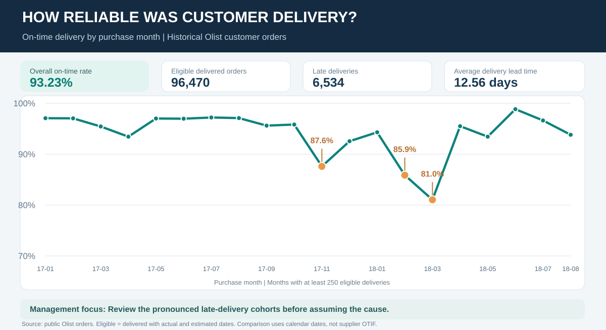
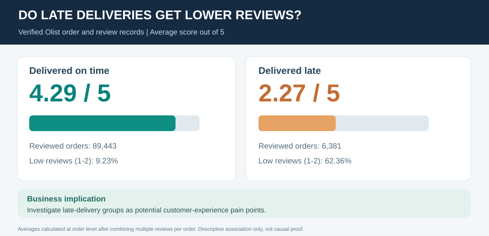
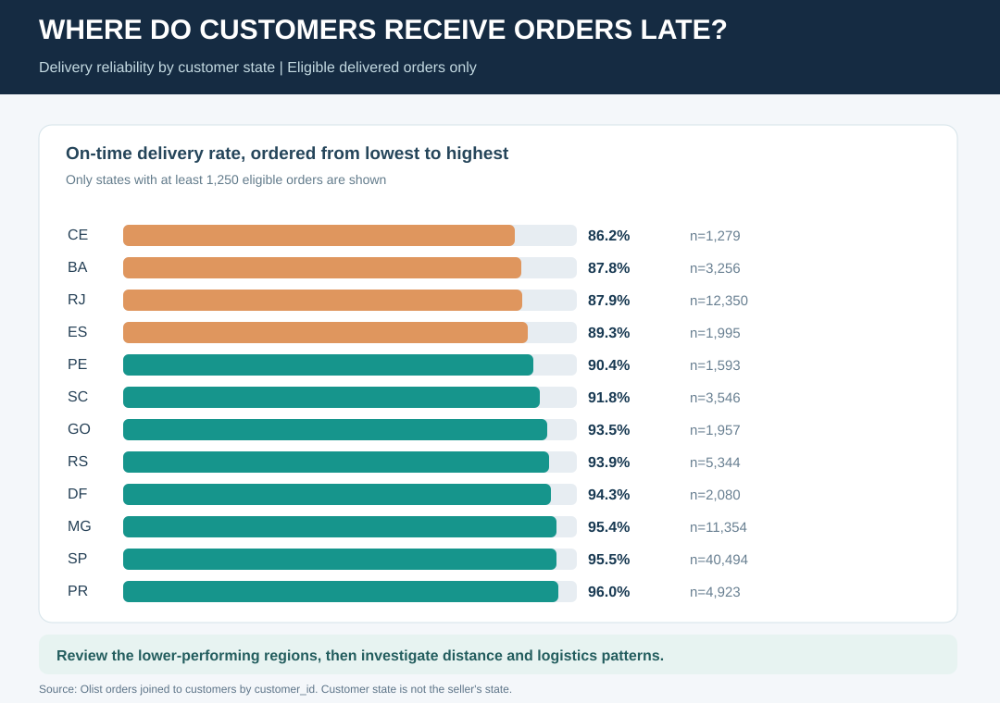
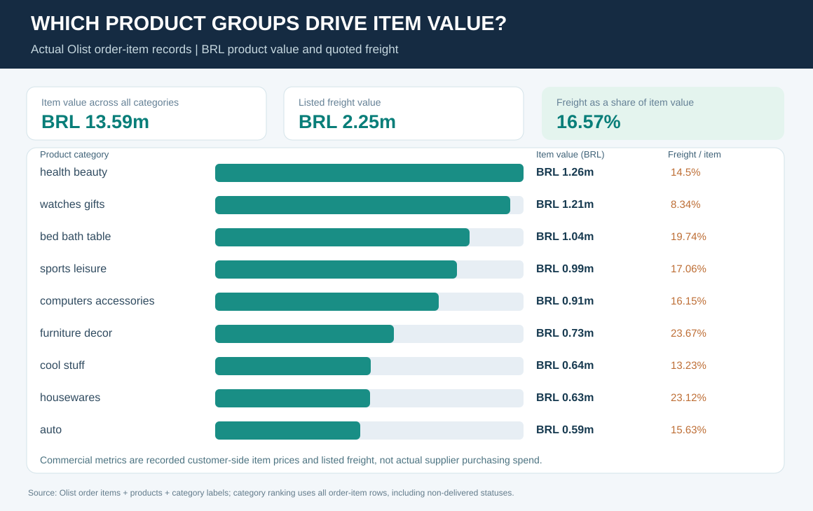

# Evidence-Based Business Findings

**Source:** Historical Olist customer orders, items, reviews, products and customer locations (Brazil, 2016-2018), accessed through a public mirror of the original Olist dataset.

## Finding 1. Delivery delays are uneven across months

**Result:** 93.23% of 96,470 eligible delivered orders reached customers on or before their estimated calendar delivery date. There were **6,534 late orders**.

The weakest significant month in the visual was **March 2018: 81.04% on time (1,328 late / 7,003 eligible)**. February 2018 was **85.87%**, while November 2017 was **87.60%**.

Together, these three purchase-month cohorts represented **3,158 (48.3%) of all late orders** and **20,846 (21.6%) of eligible orders**.

**Proposed action:** Investigate those cohorts for demand peaks, product mix and delivery geographies. Do not assume one root cause from these aggregates.

## Finding 2. Late delivery is associated with lower customer review scores

- On-time or early: **4.29 / 5** average, 89,443 eligible orders with reviews.
- Delivered late: **2.27 / 5** average, 6,381 eligible orders with reviews.
- Reviews of 1-2 stars: **9.23%** among reviewed on-time orders compared with **62.36%** among reviewed late orders.

Averaging review scores **within order** prevents multiple review events from giving one order extra weight. These are **observed associations**, not causal claims.

**Proposed action:** Review delivery-related customer complaints and processes for the late-delivery group.

## Finding 3. Delivery reliability differs across customer states

Among larger eligible groups, **Ceará 86.24% (n=1,279)**, **Bahia 87.84% (n=3,256)** and **Rio de Janeiro 87.89% (n=12,350)** had lower on-time customer-delivery rates than the overall average of 93.23%.

**Proposed action:** Compare delivery distances, product categories and shipping patterns before prioritising operational interventions.

## Finding 4. Product categories carry different freight exposure

Across **112,650 order-item rows**, published item prices total **BRL 13,591,643.70**, with **BRL 2,251,909.54** in quoted freight values. The ratio is **16.57%**. These are **customer-side fields** and not auditable carrier invoices or supplier purchase costs.

**Proposed action:** Examine high-freight categories and their product weight and size fields, distinguishing shipping charges from verified logistics costs.

## Finding 5. Seller location is concentrated

Earlier verified seller records include **3,095 seller IDs**, with **1,849 (59.7%)** in São Paulo state. This measures seller population, not actual order throughput.

[Seller location graphic](../evidence/seller_state_concentration.svg).

## Data quality and interpretation boundaries

- **99,441 orders**, including 96,478 marked delivered; **8 delivered orders lack an actual customer-delivery date**. The eligible on-time cohort is therefore **96,470**.
- On-time compares **calendar dates** (customer delivery vs estimated delivery), not supplier inbound OTIF or a contractual carrier SLA.
- Multiple payments, order items and reviews are kept at their own grains before order-level aggregation. Do not sum attributed orders across sellers or categories.
- **Customer payment value is not supplier spend.** The publication does not contain inventory or upstream purchase-order receipts.
- Relationships in this report do not prove causality, profitability or achieved savings.

Read the [management brief](09_management_brief.md) for decision-focused reporting, the [KPI dictionary](03_kpi_dictionary.md) for definitions, and the [aggregate evidence files](../evidence/) for numerical source calculations.
