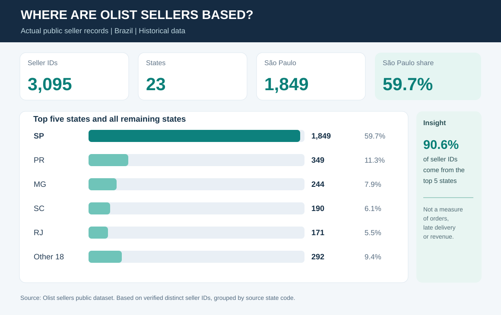
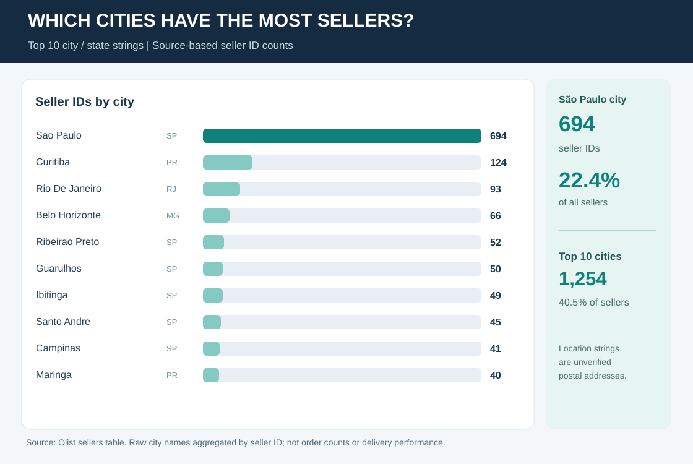
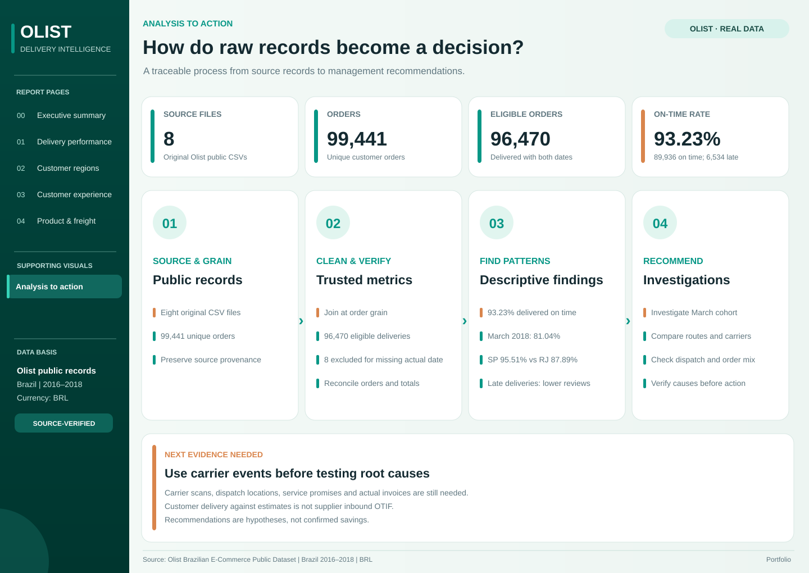

# Management Brief - Olist Seller Network

**Business question:** Where is the seller population concentrated, and what should the operations team examine before making decisions about marketplace coverage or delivery performance?

**Source:** Real Olist seller records from Brazil, 2016-2018. The published analysis includes **3,095 distinct seller IDs** across 23 Brazilian states. It does not include validated customer-order delivery metrics.

## What the data shows

**Finding 1 - Regional concentration:** São Paulo accounts for **1,849 of 3,095 seller IDs (59.7%)**. The five largest states combined account for **2,803 seller IDs (90.6%)**.

**Finding 2 - City concentration:** The city string `sao paulo, SP` has **694 seller IDs (22.4% of the seller population)**. The ten most frequent city/state strings together account for **1,254 seller IDs (40.5%)**.

These are counts of **marketplace seller IDs**, not confirmed addresses, warehouses, revenue, delivered orders or freight exposure.

## Questions for an operations review

| Management question | Evidence-based action | Additional data needed |
|---|---|---|
| Do we rely heavily on sellers in one geographic area? | Review the state and city concentration shown above. | Customer demand by location and seller order volume before assessing actual operational dependency. |
| Where should distribution coverage be reviewed first? | Compare seller representation with customer demand, not seller count alone. | Customer postcode/state, order items and delivery history. |
| Are some customer orders late or costly to fulfil? | Measure on-time delivery, lead time and freight only when original transaction files are loaded. | Original Olist orders, order items and estimated/actual delivery dates. |

## Recommended next phase

**Priority 1:** Load the full original Olist order dataset and verify the number of orders and coverage of estimated/actual delivery dates.

**Priority 2:** Compare customer on-time delivery by purchase month and investigate late-delivery concentrations. Include data coverage and the eligible denominator beside every KPI.

**Priority 3:** Review freight-to-item value and customer ratings for orders grouped by delivery timing. The relationship may indicate areas to investigate but is not proof of causation.

## Evidence boundary

The project currently delivers **seller geography analysis**, not a measured customer delivery or inbound supplier OTIF assessment. The public Excel workbook marks unavailable order-level results **Not loaded**. The source is historical Brazilian marketplace data, not a live operation or a New Zealand company.

**Review materials:** [Project overview](../README.md) | [Excel dashboard](../workbook/Olist_Order_Fulfilment_Intelligence.xlsx) | [Source data summaries](../data/reference/PROVENANCE.md) | [KPI definitions](03_kpi_dictionary.md).
