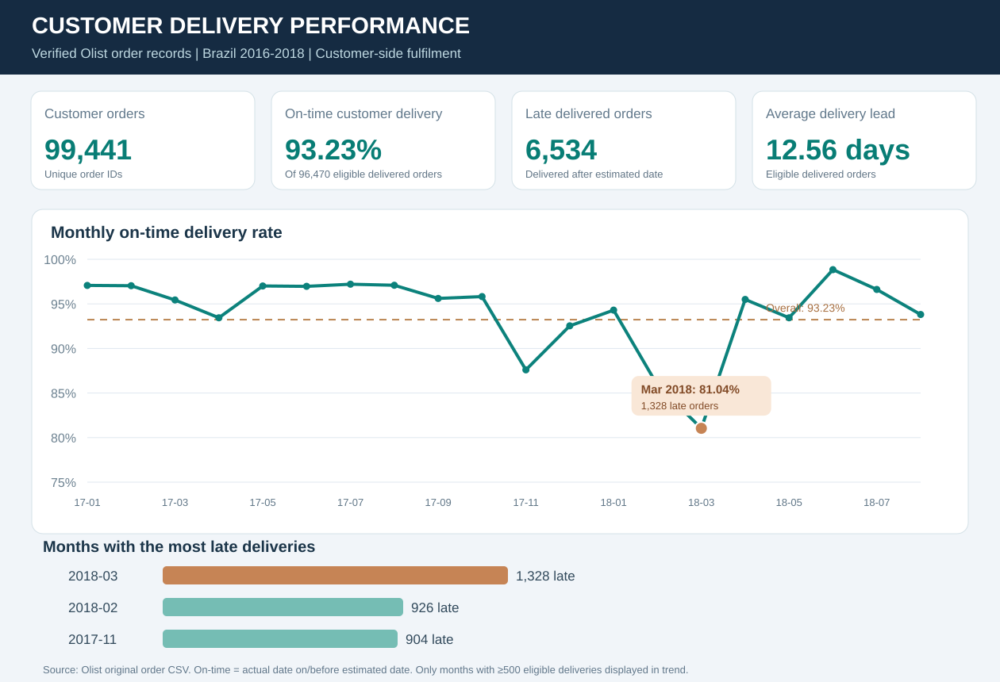
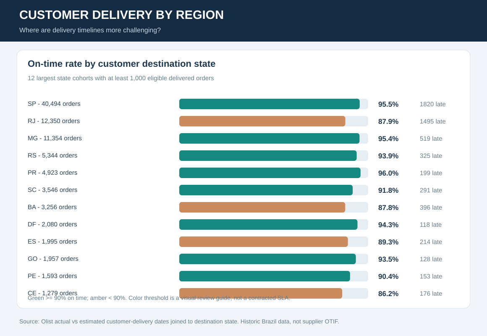
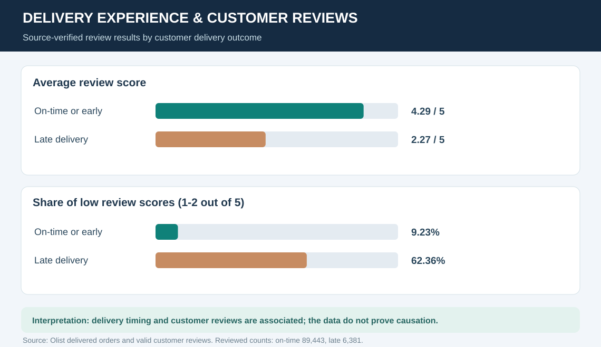
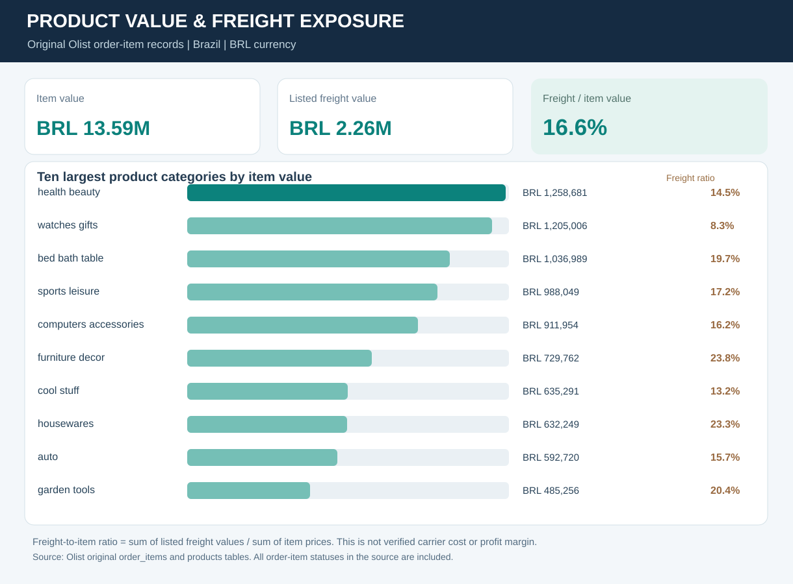

# Customer Delivery and Fulfilment - Management Findings

**Data basis:** 8 original Olist CSVs, downloaded from [Olist's own public repository](https://github.com/olist/work-at-olist-data) and reconciled using the [published calculation script](../scripts/process_olist.py). Source covers historical Brazilian marketplace activity in 2016-2018. Monetary values are in BRL.

## What did we learn?

**Finding 1 - Delivery reliability is high overall but varies materially by period.** Across 99,441 orders, 96,478 have status delivered; 96,470 of those have both actual and estimated delivery dates. **89,936 of the eligible orders were delivered on or before the estimated calendar date (93.23%), while 6,534 arrived later**. Mean purchase-to-delivery lead time for the eligible cohort is **12.56 days**.

**Finding 2 - March 2018 is a key period for investigation.** Among 7,003 eligible March-2018 orders, **1,328 arrived late**, making the on-time rate **81.04%**. Other notable purchase-month cohorts were February 2018 (**85.87%, 926 late**) and November 2017 (**87.60%, 904 late**). These findings are not evidence of a specific carrier, inventory or warehouse root cause.

**Finding 3 - Customer delivery varies by destination.** São Paulo (SP) had **95.51%** on-time delivery across **40,494** eligible orders; Rio de Janeiro (RJ) had **87.89%** across **12,350**. Ceará (CE) had **86.24%** across **1,279**. Denominators differ significantly. These figures refer to the customer's destination state, not the seller's warehouse location.

**Finding 4 - Late delivery is associated with lower customer reviews.** Eligible on-time/early orders with valid reviews average **4.29/5** (89,443 reviewed orders). Late orders average **2.27/5** (6,381 reviewed orders). Low review scores (1-2/5) appear in **9.23%** and **62.36%** of the reviewed orders respectively. This is an association, not proof that delivery timing alone determines customer satisfaction.

**Finding 5 - Freight exposure differs across product categories.** The original order-items contain **BRL 13,591,643.70** in listed merchandise price and **BRL 2,256,599.44** in listed freight value, equivalent to **16.60%** of item value. These are customer-side listed values, not invoice-verified transport cost or upstream supplier spending.

## Suggested management follow-up

| Priority | Business decision | Supporting evidence | Next information to obtain |
|---|---|---|---|
| 1 | Review delivery-service exceptions for March 2018 and other low-performing periods. | Monthly late counts and eligible on-time rates. | Carrier event logs, service promise rules and backlog evidence before assigning cause. |
| 2 | Investigate whether regional service patterns need different delivery approaches. | Customer-state on-time rates with denominators. | Dispatch origin, carrier, distance and SKU mix. |
| 3 | Prioritise reviewing late orders with negative customer feedback. | Significant observed review-score association. | Contact-resolution outcomes and customer-service interventions. |
| 4 | Examine categories with relatively high listed freight to item value. | Category-level merchandise and freight summaries. | Actual carrier invoices and profit/contribution information before claiming cost savings. |

## Data quality and KPI boundaries

- One distinct `order_id` is counted once. Items, payments and reviews are aggregated before joining, avoiding accidental duplicate value totals.
- **Eight** orders with status delivered have no actual delivery date and are excluded from the on-time denominator.
- The source uses the order status `canceled`; this has been incorporated into the cancellation calculation. There are **625 canceled orders (0.63% of the observed order population)**.
- Monthly, category and source-key reconciliations pass. [Validated totals](../data/processed/kpi_summary.json), [monthly evidence](../data/processed/monthly_metrics.csv), [regional evidence](../data/processed/customer_region_summary.csv) and [review evidence](../data/processed/review_by_delivery.csv) are published without individual order or customer identifiers.
- This analysis measures **customer on-time delivery against estimated delivery dates**, not supplier inbound OTIF. Olist does not contain upstream purchase orders, goods-receipt quantities, verified carrier invoices or a stock ledger.
- Source attribution: [Olist data publisher](https://www.kaggle.com/datasets/olistbr/brazilian-ecommerce), with [retrieved source commit and method](../data/processed/PROVENANCE.json). Underlying data reuse is subject to the publisher's licence terms.

**Project context:** independent historical portfolio analysis, not a live business implementation or a claim of measured savings.
