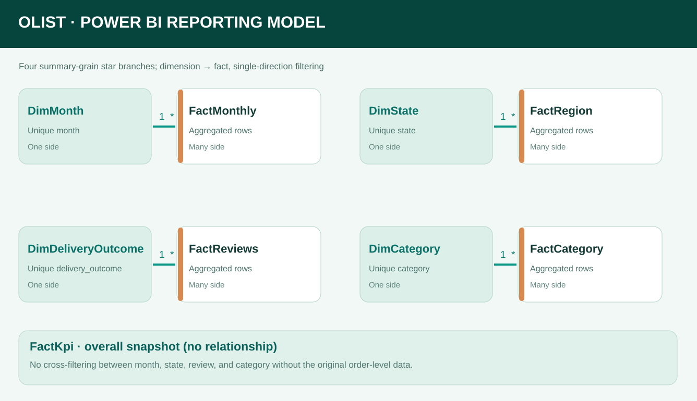

# Power BI report model — design and status

This document describes how the four-page [Olist Delivery Intelligence PDF](../reports/Olist_Delivery_Intelligence_Report.pdf) can be recreated using **Microsoft Power BI**. It documents a model and a proposed implementation; it does **not** assert that a finished Power BI report has already been opened or validated in Desktop.



## Data sources

The current GitHub repository publishes **aggregate results**, not the original order-level rows. For a like-for-like recreation of the PDF, use:

| Reporting fact | Source | Grain | Dimension |
|---|---|---|---|
| FactMonthly | [monthly_metrics.csv](../data/processed/monthly_metrics.csv) | Purchase month | DimMonth |
| FactRegion | [customer_region_summary.csv](../data/processed/customer_region_summary.csv) | Customer destination state | DimState |
| FactReviews | [review_by_delivery.csv](../data/processed/review_by_delivery.csv) | On-time vs late delivery | DimDeliveryOutcome |
| FactCategory | [category_summary.csv](../data/processed/category_summary.csv) | Product category | DimCategory |
| FactKpi | [kpi_summary.json](../data/processed/kpi_summary.json) | One all-time snapshot | No relationship |

Set each relationship **1-to-many, single-direction from dimension to fact**. This is a **multi-fact reporting constellation** (four small star branches), not a fully unified order-level star schema. The snapshot is deliberately disconnected.

## Measures and checks

Use DAX measures derived from count and value columns, rather than averaging percentages:

```DAX
On-time Deliveries = SUM(FactMonthly[on_time_deliveries])
Eligible Deliveries = SUM(FactMonthly[on_time_eligible])
On-time Rate = DIVIDE([On-time Deliveries], [Eligible Deliveries])

Listed Freight = SUM(FactCategory[freight_brl])
Item Value = SUM(FactCategory[item_value_brl])
Freight to Item Rate = DIVIDE([Listed Freight], [Item Value])
```

Keep the line chart at **Jan 2017–Aug 2018** and the last-12-month late-deliveries chart at **Sep 2017–Aug 2018**. Ignore months with no delivery-eligible orders, to avoid an invalid line endpoint.

Expected totals: **99,441 orders**, **96,470 eligible deliveries**, **89,936 on time (93.23%)**, **6,534 late**, **625 canceled**, **112,650 order-item lines**. The PDF shows 4.29 vs 2.27 reviewed average scores and BRL 13.59M item value vs BRL 2.26M listed freight.

## Limits

Summary-level data cannot answer cross-dimension questions such as *late deliveries by product category and customer state*. That would require a future model built from the eight original Olist CSVs with **FactOrders at order grain**, **FactOrderItems at item grain** and dimensions including purchase date, customer destination and category. Aggregate items, payments and reviews to order grain before joining so KPIs are not multiplied.

On time means delivery by the estimated **customer** date, not supplier inbound OTIF. Listed freight is not audited carrier expense; delivery timing and review score association does not establish causation.

## Portfolio wording

Until a four-page report has actually been created, refreshed and checked in Power BI Desktop, label this work **“Power BI model design / prototype”**. After validation, it is fair to say **“Data visualisation: Power BI”**, and to publish screenshots and the exported PDF while keeping the PBIX locally. Uploading a PBIX to GitHub is optional.
