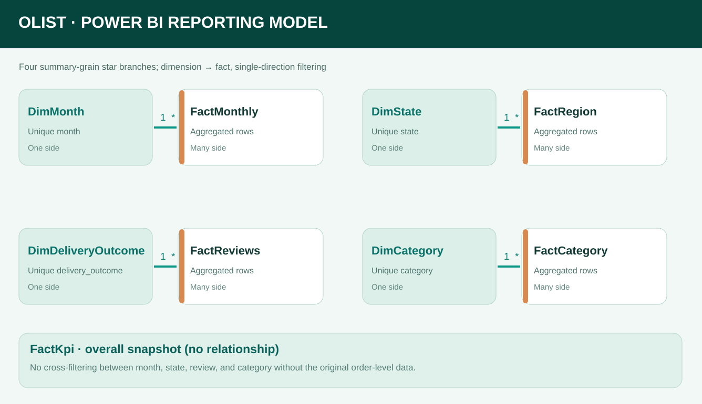

# Semantic model and Power Query

This describes the **actual nine-table model in the PDF-style PBIP project**. It is a **multi-fact constellation built from published aggregates**, not a universal order-level star schema. The PBIP stays local; these notes and source-derived aggregates are safe to review in GitHub.



## Import design

The project uses Power BI Desktop **Import** mode. The local, offline Power Query partitions load a copy of five repository aggregate datasets embedded as Base64 text within the TMDL M expressions (using `Binary.FromText(..., BinaryEncoding.Base64)`).

| Power BI table | Original public repository file | Row grain | Primary purpose |
|---|---|---|---|
| `FactMonthly` | [monthly_metrics.csv](../../data/processed/monthly_metrics.csv) | 1 purchase month | Trend charts, eligible/on-time/late counts |
| `FactRegion` | [customer_region_summary.csv](../../data/processed/customer_region_summary.csv) | 1 customer destination state | Regional service charts and comparisons |
| `FactReviews` | [review_by_delivery.csv](../../data/processed/review_by_delivery.csv) | 1 delivery outcome (`on_time`, `late`) | Review scores and low-rating share |
| `FactCategory` | [category_summary.csv](../../data/processed/category_summary.csv) | 1 product category | Listed item value, freight and item lines |
| `FactKpi` | [kpi_summary.json](../../data/processed/kpi_summary.json) | 1 all-time snapshot | Four-page headline KPIs |
| `DimMonth` | Distinct month values from monthly data | 1 month | Labels and filters for `FactMonthly` |
| `DimState` | Distinct states from regional data | 1 state | Labels and filters for `FactRegion` |
| `DimDeliveryOutcome` | Distinct outcomes from review data | 1 outcome | Display labels for `FactReviews` |
| `DimCategory` | Distinct categories from category data | 1 category | Display labels for `FactCategory` |

**Relationships, as defined in `relationships.tmdl`:**

| Fact foreign key | Dimension unique key | Cardinality | Filter direction |
|---|---|---|---|
| `FactMonthly[month]` | `DimMonth[month]` | Many-to-one | Dimension → fact |
| `FactRegion[state]` | `DimState[state]` | Many-to-one | Dimension → fact |
| `FactReviews[delivery_outcome]` | `DimDeliveryOutcome[delivery_outcome]` | Many-to-one | Dimension → fact |
| `FactCategory[category]` | `DimCategory[category]` | Many-to-one | Dimension → fact |

`FactKpi` remains deliberately **disconnected**. It holds all-time values that must not be silently reinterpreted as state/month/category-specific numbers. Avoid bidirectional filters and direct fact-to-fact joins.

## How the Power Query tables are created

1. Start from the five [source-derived aggregate files](../../data/processed/), generated and checked by the Python ETL. This is **not** a live refresh of all eight raw CSVs inside Power BI.
2. Embed the CSV/JSON payload into each Import partition for **offline refresh**. The CSV pattern is:

   ```powerquery
   let
       Raw = Csv.Document(
           Binary.FromText("<BASE64_UTF8_CSV>", BinaryEncoding.Base64),
           [Delimiter=",", Encoding=65001, QuoteStyle=QuoteStyle.Csv]
       ),
       Headers = Table.PromoteHeaders(Raw, [PromoteAllScalars=true]),
       Typed = Table.TransformColumnTypes(Headers, {{"month", type text}}, "en-US")
   in
       Typed
   ```

   `FactKpi` uses `Json.Document(Binary.FromText(..., BinaryEncoding.Base64))`, selects the required KPI fields, converts the record to a one-row table and applies numeric types.
3. Derive dimensions with `Table.SelectColumns`, `Table.Distinct` and `Table.TransformColumnTypes` from their matching facts; do **not** derive a join between unrelated aggregates.
4. Add friendly text in dimension display columns: `on_time` → **On time or early**, `late` → **Late delivery**, `health_beauty` → **Health & beauty**, etc. Keep original keys for relationships and grouping.
5. Create the four one-to-many relationships above. Apply DAX measures from [measures.dax](measures.dax).

For an always-updated implementation, replace embedded M payloads with the same published CSV/JSON files (or regenerate the aggregates from raw data), then review Power Query privacy levels and source refresh behavior. The current offline project is a reproducible **snapshot**, not a scheduled connector.

## Grain and metric rules

- **Eligible delivery:** order status delivered; both actual customer delivery and estimated dates available. Eight delivered orders have no actual date and are excluded.
- **On time:** actual customer delivery date on or before estimated calendar date. Overall `89,936 / 96,470 = 93.23%`.
- **Month:** purchase month, not carrier handover/delivery month. The line chart shows Jan 2017–Aug 2018; the 12-month late chart shows Sep 2017–Aug 2018.
- **Destination:** state is the **customer's** state, not the seller's state.
- **Review analysis:** averages are weighted by distinct reviewed-order counts. The aggregate review scores are already rounded, so cross-group weighted results are descriptive approximations; within-group displayed values match the published figures.
- **Category:** item price and listed freight come from original order-item rows. `order_count_attributed` across categories is **not additive as unique marketplace orders**, because orders can contain several categories.
- **Freight:** listed order-item freight is **not** a verified invoice paid to a carrier.
- **Scope of interaction:** dimension filters operate only on their own fact branch. There is no valid cross-filter for questions like “late orders in category X and state Y” without order/item-level records.

## What a future order-level star schema would need

If cross-page interactive slicing is required, build a separate `FactOrders` at one row per order and `FactOrderItems` at one row per order item, with shared dates, customer and category dimensions. Aggregate reviews, payments and item values to the correct grain **before** joining; otherwise repeated rows can inflate order counts and financial totals.

This design should not be described as proof of a full order-level Power BI data warehouse.

## Verification

The repository contains the five aggregate sources and [data-quality notes](../04_data_quality.md). The local Power BI project contains 9 tables and **56 measures** (8 monthly, 11 regional, 12 review, 8 category, 17 headline/display). They are recorded in [measures.dax](measures.dax), while report wiring is described in [report_pages.md](report_pages.md). Pixel-level appearance of the PDF-style PBIP still requires opening and checking it on Power BI Desktop.
