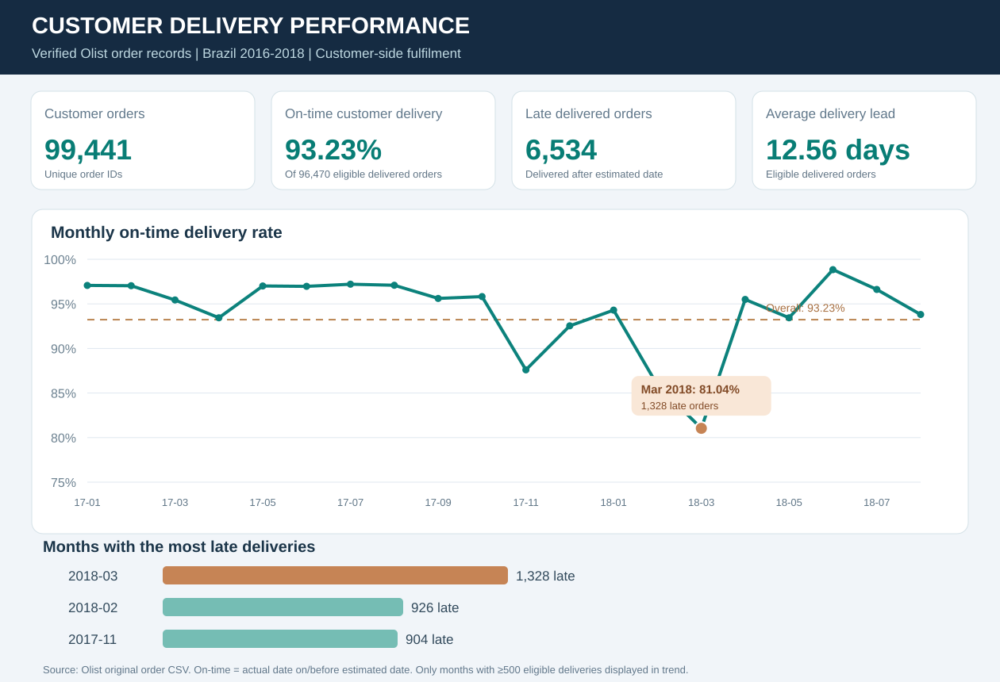
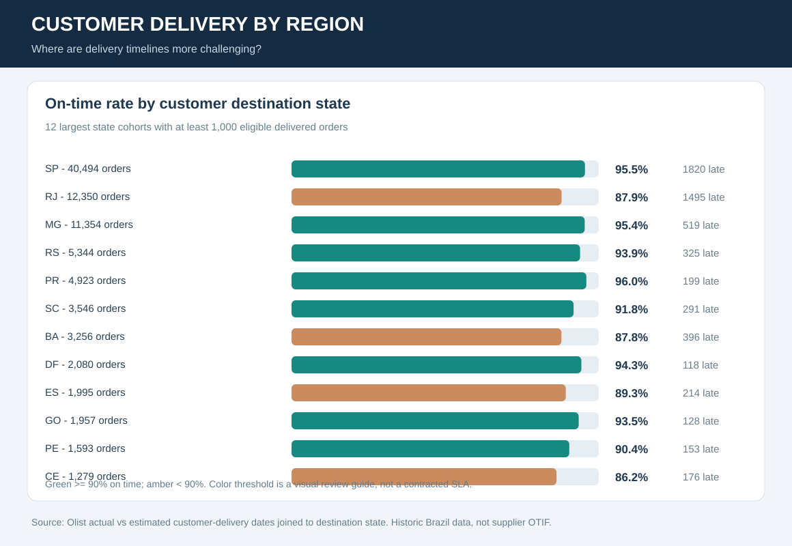
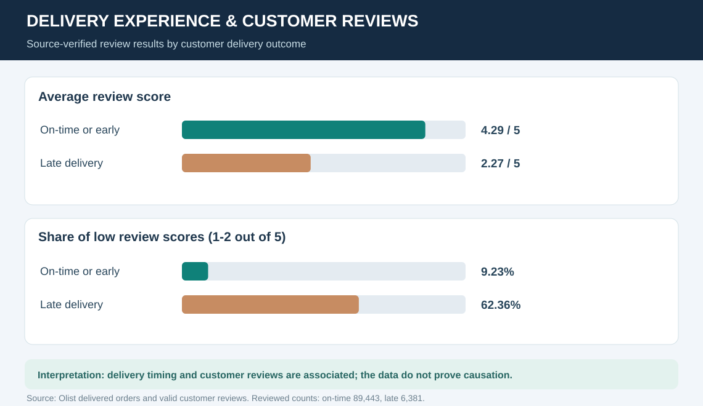
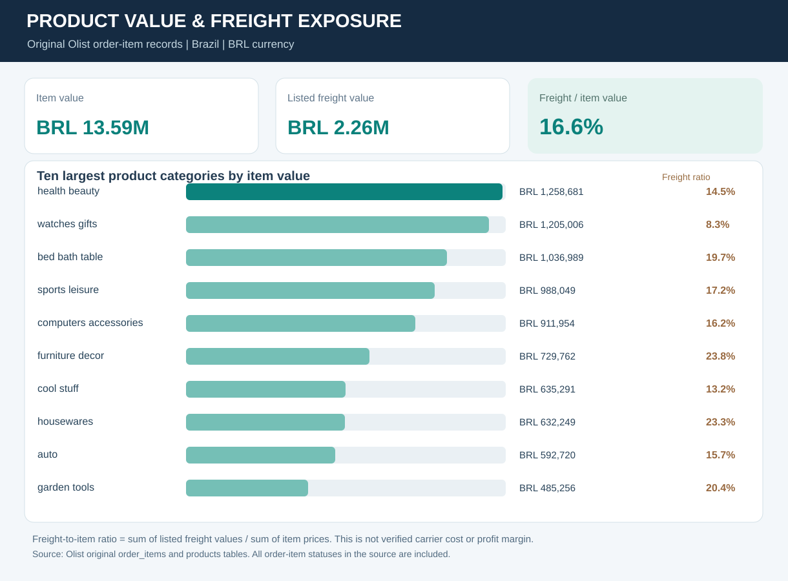

# Visual Evidence - Olist Order Fulfilment

**All four customer-delivery charts below are based on source-verified Olist aggregates.**

## Customer delivery and experience

## Seller network context

[Seller state concentration](seller_state_concentration.svg) | [Top seller cities](top_seller_cities.svg) | [Business analysis workflow](analysis_to_action.svg).

## Reproduce or verify the numbers

- [Overall KPI summary](../data/processed/kpi_summary.json)
- [Monthly delivery aggregates](../data/processed/monthly_metrics.csv)
- [Regional delivery aggregates](../data/processed/customer_region_summary.csv)
- [Delivery and review aggregates](../data/processed/review_by_delivery.csv)
- [Product-category values](../data/processed/category_summary.csv)
- [Original Olist source commit and provenance](../data/processed/PROVENANCE.json)

The raw individual order, customer and review records are not republished. This is a historical Brazil 2016-2018 study using BRL; on-time delivery is measured against the customer's estimated date, not supplier OTIF. Listed freight is not a verified carrier invoice and review association does not establish causation.
